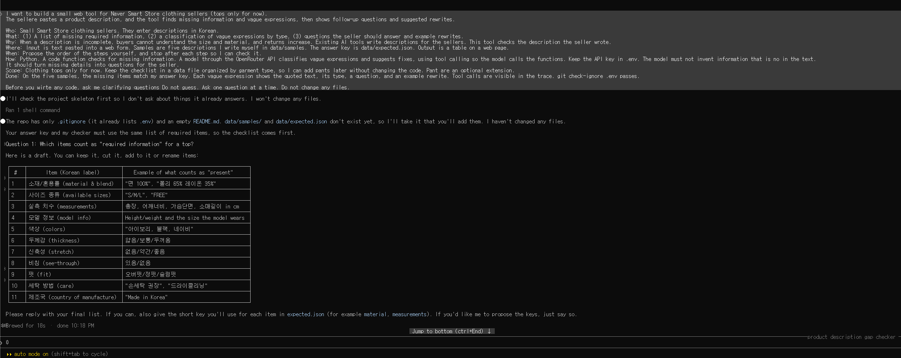
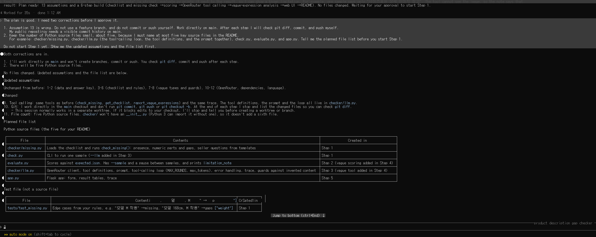
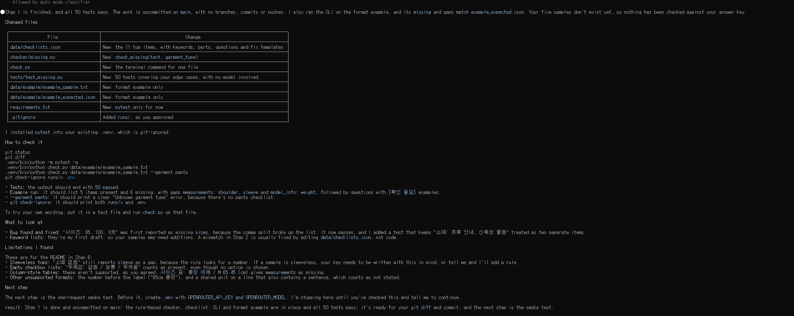
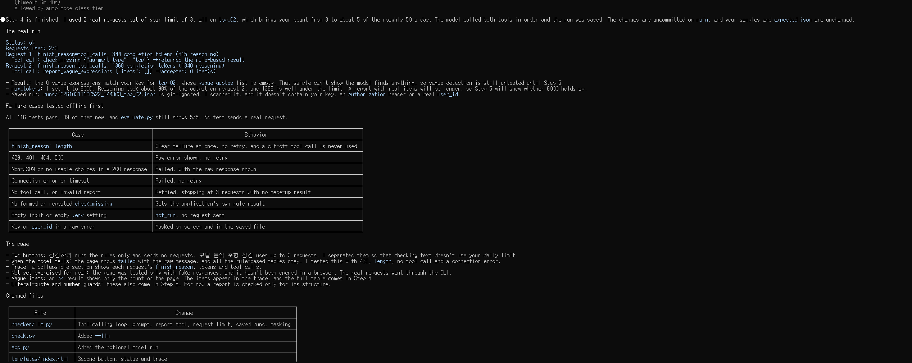
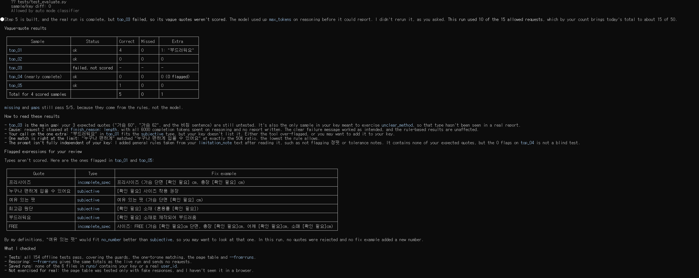
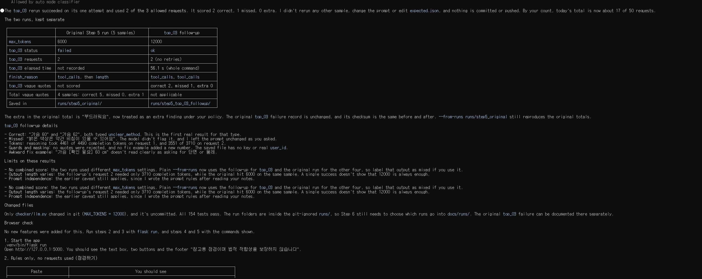

# 의류 상품 설명 점검 도구(apparel-desc-checker)

스마트스토어에서 상의를 판매하는 사람이 작성한 상품 설명을 쓸 때 빠뜨린 정보를 찾도록 만든 Python, Flask 웹앱입니다. 작성한 글을 붙여 넣으면 부족한 정보와 애매한 표현을 찾아 질문과 보완 예시를 보여 줍니다. 판매글을 새로 써 주는 것보다 이미 쓴 글을 점검하는 데 초점을 맞췄습니다.

## 주요 기능과 범위

소재, 판매 사이즈, 실측, 모델 정보, 색상, 두께, 신축성, 비침, 핏, 세탁법, 제조국의 11개 항목을 확인합니다. 이번 프로젝트에서는 상의 텍스트만 다루며 이미지 분석, 가격 추천, 플랫폼 연동은 제외했습니다.

누락된 정보는 코드의 규칙으로 검사합니다. 예를 들어 실측은 항목명과 숫자, 단위가 함께 있어야 인정하고 일부 치수만 있으면 빠진 항목을 따로 표시합니다. 표 위에 한 번 적힌 공통 단위도 같은 실측 블록 안에서는 적용합니다.

애매한 표현 분석에는 OpenRouter 모델을 사용합니다. 모델이 `check_missing`을 요청하면 프로그램이 검사 결과를 반환하고 모델은 `report_vague_expressions`로 보고서를 제출합니다. 요청은 재시도를 포함해 최대 3회로 제한했습니다. 모델 분석이 실패해도 규칙 검사 결과는 볼 수 있습니다.

결과에서는 원문에서 찾은 표현과 판매자가 채울 내용을 구분했습니다. 원문에 없는 인용은 제외하고 보완 예시에 새 숫자가 들어가면 표시합니다. 알 수 없는 값은 `[확인 필요]`로 남깁니다.

## 실행 방법

Linux/WSL 기준으로 저장소 폴더에서 실행합니다.

```bash
python3 -m venv .venv
.venv/bin/python -m pip install -r requirements.txt
cp .env.example .env
.venv/bin/flask run
```

브라우저에서 `http://127.0.0.1:5000`을 열면 됩니다. 규칙 검사는 API 키 없이 사용할 수 있습니다. AI 분석을 사용하려면 `.env`에 `OPENROUTER_API_KEY`와 `OPENROUTER_MODEL`을 설정합니다. 검증에 사용한 모델은 `nvidia/nemotron-3.5-super-vl:free`입니다.
```bash
.venv/bin/python check.py data/samples/top_02.txt
.venv/bin/python evaluate.py
.venv/bin/python -m pytest -q
```

위 세 명령은 모델 요청을 보내지 않습니다. `check.py --smoke`는 실제 요청 1회를 보내고 `evaluate.py --llm --sample top_03`은 해당 샘플을 실제 모델로 분석하며 웹의 모델 분석 버튼도 실제 요청을 사용합니다.

CLI 실행, 정답표 비교, 테스트는 다음과 같습니다. 이 명령들은 모델 요청을 보내지 않습니다.

```bash
.venv/bin/python check.py data/samples/top_02.txt
.venv/bin/python evaluate.py
.venv/bin/python -m pytest -q
```
실제 모델 연결을 확인하려면 `check.py --smoke`를 사용해야 하며 이때는 요청 1회가 발생합니다. 웹의 AI 분석 버튼도 실제 모델을 호출합니다.

공개한 실행 기록은 아래 명령으로 다시 채점할 수 있습니다. 새로 모델을 호출하는 것이 아니라 저장된 응답을 평가하는 기능입니다.

```bash
.venv/bin/python evaluate.py --from-runs docs/runs/step5_original
.venv/bin/python evaluate.py --from-runs docs/runs/step5_top_03_followup --sample top_03
```

기록 구성과 공개 전에 가린 값은 [실행 기록 설명](docs/runs/README.md)에 정리했습니다.

## 작업 과정

처음에는 대상 사용자와 필요한 기능, 완료 기준을 설명하고 바로 코딩하지 말고 질문부터 해 달라고 요청했습니다. 질문에 답하면서 무엇을 누락으로 볼지 정했습니다. 특히 숫자 없는 치수는 누락으로 보고 치수가 일부만 있는 경우는 `gaps`로 구분했습니다.

규칙 검사와 테스트부터 시작해 모델 연결, 채점, 웹 화면, AI 분석 순서로 구현했습니다. 각 단계의 변경 내용을 확인하며 진행했습니다. 

상품 설명 5개를 작성하고 정답표의 기준을 검토한 뒤 평가에 사용했습니다. 결과에 맞춰 정답표를 바꾸지는 않았지만 같은 샘플을 프롬프트 설계에도 사용했기 때문에 독립적인 평가로 볼 수는 없습니다.

### Claude Code 증거

#### 1. 목적과 범위 정하기
대상 사용자와 완료 기준을 설명하고, 코딩 전에 질문을 요청했습니다.



#### 2. 계획 검토하기
제안받은 가정을 읽고 작업 방식과 파일 구성을 조정했습니다.



#### 3. 규칙 검사와 오류 수정
숫자 사이즈 목록을 쉼표로 나누면서 누락으로 판단한 오류를 고쳤습니다. 1단계 테스트에서 50개 통과를 보고받았습니다.



#### 4. 실제 도구 호출 확인
두 도구가 순서대로 호출되고 요청 2회로 완료된 기록입니다.



#### 5. 최초 검증 결과
샘플 5개 중 AI 분석은 4개가 완료됐고 `top_03`은 실패했습니다.



#### 6. 실패 사례 재실행
설정을 바꿔 `top_03`을 다시 실행하고 최초 결과와 따로 기록했습니다.



## 검증 결과

누락 항목과 `gaps`는 정답표와 집합으로 비교했습니다. 인용문은 일대일로 대응시키고, 완전 일치 또는 제한된 부분 일치를 인정했습니다. 부분 일치는 짧은 쪽이 3자 이상이면서 긴 쪽 길이의 절반 이상일 때만 인정합니다. 표현 유형과 보완 예시의 적절성은 사람이 확인했습니다.

| 실행 | 규칙 검사 | AI 분석 | 인용문 결과 | 요청 |
|---|---|---|---|---|
| 최초 5개, max_tokens 6000 | 5/5 일치 | 4개 완료, top_03 실패 | 완료된 4개: 일치 5, 놓침 0, 과다 1 | 10 |
| top_03 후속, max_tokens 12000 | 1/1 일치 | 완료, 56.1초 | 일치 2, 놓침 1, 과다 0 | 2 |

최초 `top_03`은 추론에 토큰 한도를 사용하면서 보고서가 잘렸습니다. 재실행에서는 가슴 치수의 측정 방법 문제 두 개를 찾았지만 비침 표현을 놓쳤습니다. 후속 두 번째 응답은 3,710토큰만 사용했으므로 한도를 늘린 것이 성공 원인이라고 단정할 수는 없습니다. 두 실행은 설정이 달라 합산하지 않았습니다.

`top_01`의 ‘부드러워요’는 정한 기준보다 넓게 지적한 사례였습니다. 이후 웹 시연에서는 같은 입력에 대한 지적 여부와 인용 길이가 달라져 결과가 실행마다 달라질 수 있다는 점도 확인했습니다.

개발에 쓰지 않은 실제 판매자 글 1개도 추가로 넣어 봤습니다. 누락으로 나온 4개 중 세탁법과 제조국은 입력한 글에 없었습니다. 하지만 실측 숫자와 모델의 키와 몸무게는 있는데도 누락으로 나왔습니다. 실측에 단위가 없으면 제외하는 규칙과 여러 줄의 모델 정보를 읽지 못하는 문제가 드러났습니다. 기능을 동결한 뒤 발견해 수정하지 않고 한계로 남겼습니다.

최종 테스트는 156개가 통과했습니다. 공개한 기록의 재채점은 네트워크를 막은 상태에서도 요청 없이 동작했습니다.

## 효과적이었던 방식 3가지

1. **코딩 전에 기준 정하기:** 숫자 없는 치수나 FREE 사이즈처럼 판단이 갈리는 부분을 먼저 정하니 구현 방향을 구체적으로 전달할 수 있었습니다.
2. **단계별 테스트:** 쉼표 처리 오류와 값 없는 라벨을 정보로 보는 문제를 사례로 남겼습니다. 수정 후에도 같은 오류가 생기지 않는지 확인할 수 있었습니다.
3. **규칙과 모델의 역할 나누기:** 모델이 실패해도 기본 결과를 보여 줄 수 있었습니다. 저장한 응답을 재채점하면서 추가 요청도 줄였습니다.

## 어려웠던 점 3가지

1. **무료 모델 연결:** 선택한 모델에서 404 오류가 났습니다. 모델 ID를 설정으로 분리해 두고 요청 한 번으로 대체 모델의 도구 호출을 확인했습니다.
2. **응답이 중간에 잘리는 문제:** 실패 기록을 남기고 해당 샘플만 다시 실행했습니다. 재실행 성공만으로 문제가 해결됐다고 보지는 않았습니다.
3. **검증 결과를 해석하는 일:** 직접 만든 샘플은 규칙과 잘 맞았지만 실제 글에서는 한계가 나왔습니다. 모델도 과다 지적과 놓침이 있었습니다. 실제 글 한 개의 추가 확인을 넘어 별도 샘플 집합으로 성능을 검증하지는 못했습니다.
   
## 한계

이미지 속 사이즈표는 읽지 못합니다. `총길이`처럼 등록하지 않은 표현, 단위 없는 실측, 여러 줄로 나뉜 모델 정보 등은 놓칠 수 있습니다. 민소매나 선택지만 나열한 설명에서도 규칙이 잘못 판단할 수 있고 실측을 사이즈별로 모두 검증하지는 않습니다.

인용문이 반복되면 어느 위치를 지적했는지 수동 확인이 필요합니다. 새 숫자 경고만으로 소재 변경 같은 모든 사실 변형을 막을 수도 없습니다. 보완 예시는 판매자가 확인해서 사용해야 하며 실제 상품 정보의 정확성이나 법적 적합성을 보장하지 않습니다.

## 평가용 핵심 소스 파일

| 파일 | 역할 |
|---|---|
| `checker/missing.py` | 누락, 세부 항목 검사와 질문 |
| `checker/llm.py` |  모델 요청, 도구 실행, 오류 처리와 기록 |
| `check.py` | CLI와 모델 연결 확인 |
| `evaluate.py` | 정답표 비교와 저장 응답 재채점 |
| `app.py` | Flask 웹 입력과 결과 처리 |

